&nbsp;
&nbsp;
&nbsp;
&nbsp;

 

<table width="100%">
<tr>
<td width="62%" valign="top">

WHO WE ARE

### A small senior team that owns the whole build

**TECSO** is the brand of **راهکارپرداز فن‌آوران هوشمند**, a registered software and infrastructure studio in Urmia, Iran, working since 2018. A senior core team plus project-based specialists (network, security, QA, SEO) delivers products end-to-end: **Vue / Nuxt** front-ends, **Go / Python / PHP** back-ends, the servers and networks they run on, and the documentation that lets your own team carry them forward.

</td>
<td width="38%" valign="top">

WHY TEAMS PICK US

- Written scope, weekly demos
- Your repository from day one
- Persian-native, RTL-first UX
- NDA and least-privilege access
- No vendor lock-in

</td>
</tr>
</table>

## What we do

<table width="100%">
<tr>
<td width="33%" valign="top">
01 · ENTERPRISE WEB
<h3>Software & office automation</h3>

Workflows, forms, document management, RBAC, dashboards and integrations with the systems you already run.

<code>Vue 3</code> <code>Nuxt 3</code> <code>Go</code> <code>PostgreSQL</code>
</td>
<td width="33%" valign="top">
02 · APPLIED AI
<h3>AI products & automation</h3>

Assistants on your own documents (RAG), request triage, Telegram and web bots, agents behind human approval gates.

<code>Python</code> <code>Go</code> <code>LLM APIs</code> <code>Ollama</code>
</td>
<td width="33%" valign="top">
03 · BACK-END & DATA
<h3>Services & integrations</h3>

APIs, CRMs, scrapers and data pipelines, with SMS, payment and third-party API integrations.

<code>FastAPI</code> <code>PHP</code> <code>Redis</code> <code>Playwright</code>
</td>
</tr>
<tr>
<td width="33%" valign="top">
04 · DEVOPS & NETWORKS
<h3>Servers that stay up</h3>

Linux hardening, Docker and k3s, CI/CD with test gates, encrypted backups, monitoring; network design for Cisco, MikroTik and Juniper.

<code>Kubernetes</code> <code>GitHub Actions</code> <code>Grafana</code>
</td>
<td width="33%" valign="top">
05 · UI/UX & WEB
<h3>Design systems & sites</h3>

Figma design systems, fast server-rendered corporate sites and technical SEO, in Persian and English.

<code>Figma</code> <code>Nuxt</code> <code>Tailwind</code>
</td>
<td width="33%" valign="top">
06 · DOCUMENTATION
<h3>Proposals & specs</h3>

SRS, architecture, estimates and tender responses, written for your stakeholders and delivered under your brand.

<code>SRS</code> <code>Architecture</code> <code>Tenders</code>
</td>
</tr>
</table>

## Featured work

<table width="100%">
<tr>
<td width="50%" valign="top">
REAL ESTATE · <a href="https://sorinflow.com">sorinflow.com ↗</a>
<h3><a href="https://github.com/Tecso-Dev/SorinFlow-DaTA-mAmager">SorinFlow</a></h3>

Real-estate operations platform: Divar scraper, property inventory and Persian CRM. 189 endpoints, 775 tests, k3s deploy with auto-rollback and encrypted off-site backups.

<code>FastAPI</code> <code>Playwright</code> <code>PostgreSQL</code> <code>k3s</code>
</td>
<td width="50%" valign="top">
AI SAAS · <a href="https://noxioai.com">noxioai.com ↗</a>
<h3><a href="https://noxioai.com">NOXIOAI</a></h3>

Bilingual AI-employee SaaS: named AI staff handle customer support and marketing from one workspace, with human approval on every outbound action.

<code>Go</code> <code>Nuxt 3</code> <code>PostgreSQL</code> <code>LLM APIs</code>
</td>
</tr>
<tr>
<td width="50%" valign="top">
MARKETPLACE SEARCH · OPEN SOURCE
<h3><a href="https://github.com/sobhanaz/khodrobin">KhodroBin</a></h3>

Used-car price engine across 5 marketplaces: resolves one car across listings, ranks in under a millisecond and explains with a local model behind a five-axis hallucination guard.

<code>Go</code> <code>FastAPI</code> <code>Nuxt 3</code> <code>Ollama</code>
</td>
<td width="50%" valign="top">
PHYSICAL SECURITY · <a href="https://sobhanaz.github.io/Gardian-One/">docs ↗</a>
<h3><a href="https://github.com/sobhanaz/Gardian-One">Guardian One</a></h3>

Architecture and documentation for an on-premise, AI-augmented security platform: face recognition, access control, RTLS and a full audit trail.

<code>Go</code> <code>Computer vision</code> <code>NATS</code> <code>Flutter</code>
</td>
</tr>
</table>

## What we're building right now

## How we work

<table width="100%">
<tr>
<td width="33%" valign="top"><h4>Security by default</h4>
NDA before any access, named least-privilege accounts, secrets in a password manager, access removed at hand-over.
</td>
<td width="33%" valign="top"><h4>Your code, your repo</h4>
Source, configuration and docs live in your Git. Ownership transfers on payment; changes go through a written addendum.
</td>
<td width="33%" valign="top"><h4>Remote-first</h4>
Day-to-day work is remote. Kick-offs and critical deployments can happen on-site anywhere in Iran.
</td>
</tr>
</table>

## Studio activity

## Tech we build with

  

## برای شرکت‌ها و همکاران در ایران

**راهکارپرداز فن‌آوران هوشمند** (با نام تجاری TECSO) شرکتی ثبت‌شده در ارومیه است که از سال ۱۳۹۷ در این حوزه‌ها کار می‌کند:

- نرم‌افزار سازمانی و اتوماسیون اداری
- هوش مصنوعی روی داده‌های سازمان و ربات‌های تلگرام و وب
- DevOps، سرور و پشتیبان‌گیری رمزنگاری‌شده
- طراحی و پیکربندی شبکه (Cisco، MikroTik، Juniper)
- طراحی UI/UX و سایت‌های شرکتی
- تدوین پروپوزال، SRS و اسناد مناقصه

هر پروژه با محدودهٔ مکتوب، دموی هفتگی و تحویل کامل کد و مستندات انجام می‌شود. همکاری دورکاری است و برای جلسات کلیدی حضور در محل ممکن است.

## Work with us

<table width="100%">
<tr>
<td width="62%" valign="middle">
<h3>Have a project in mind?</h3>

Send a short brief: what you need, your timeline and any systems we must integrate with. You get a written scope and estimate back.

<b>Sobhan Azimzadeh</b> · Founder & Technical Lead 
<a href="mailto:sobhan.gjhav.azimzadeh@gmail.com">sobhan.gjhav.azimzadeh@gmail.com</a> · +98 905 843 2452 · <a href="https://t.me/+989922068945">Telegram</a>

</td>
<td width="38%" valign="middle" align="center">

</td>
</tr>
</table>

TECSO · راهکارپرداز فن‌آوران هوشمند · Urmia, Iran · 3D cards rebuilt from live GitHub data every 6 hours

